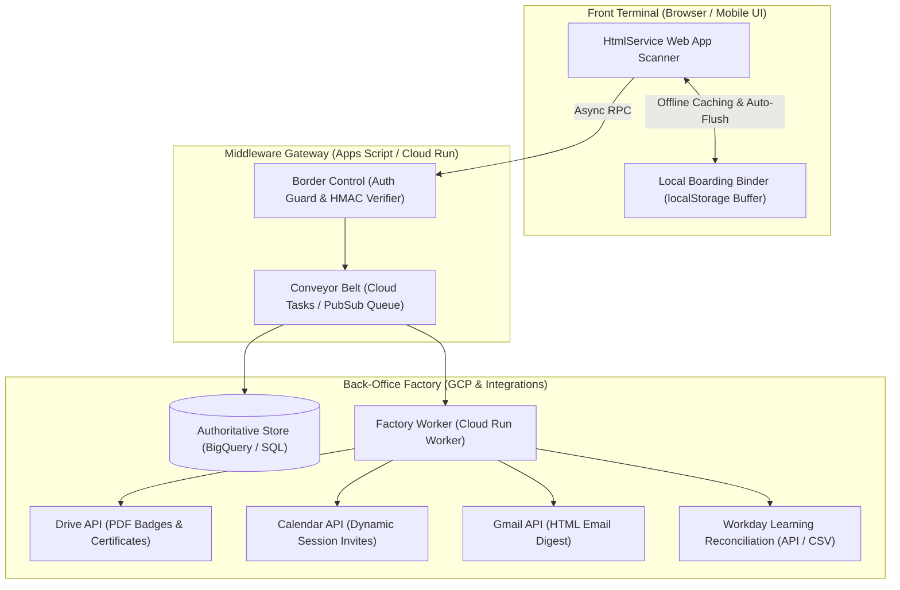
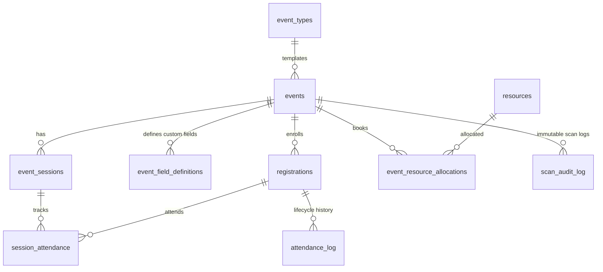
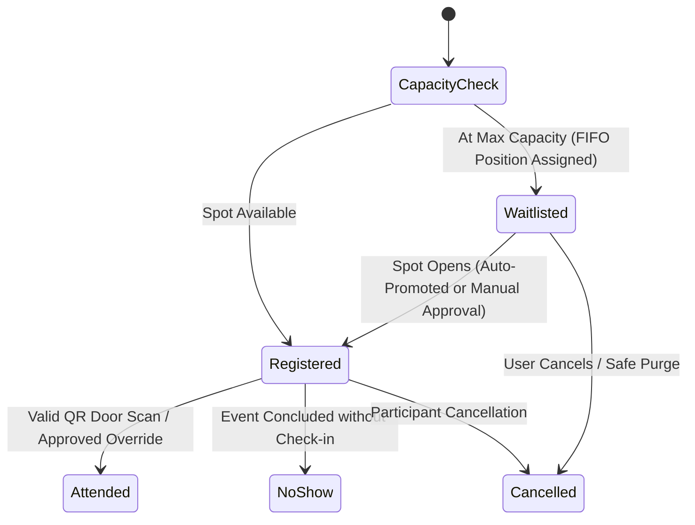

# Evently — Phase 1: Blueprint & Learning Architecture Guide

> [!NOTE]
> **VibeWise + Ponytail + human-teacher-writer Edition**  
> Rewritten with the **VibeWise Learning Framework** (`✦ Concept`, `✦ Why this matters`, `✦ Checkpoints`), refined with **Ponytail's Senior Developer Principles** (minimal code, standard library first, zero unrequested abstraction, explicit shortcut tracking), and all `✦ Concept` blocks rewritten using the **human-teacher-writer Writing Ladder** (familiar scenario → problem → analogy → term → example → rule).

---

## 1. System Topology: The Airport Terminal Mental Model

---
### ✦ Concept

It's 8:55 AM. Fifty people are lined up at the conference room door for a 9:00 AM keynote. Each person holds up their phone, the scanner flashes green, and they walk in. That scan takes under one second.

But the system also needs to generate a PDF certificate, update the HR system, and send a confirmation email. Each of those tasks takes 5–15 seconds. If the scanner waited for all of them, person #1 would stand there for 15 seconds — and the queue would grind to a halt.

**The fix:** make the scanner do one job only — check the ticket and let the person in. Hand everything else to a back-room worker to finish quietly after the door has already moved on.

That separation — "fast door check" vs. "slow background work" — is called an **asynchronous gateway pattern**. Think of it like an **Airport Check-In Terminal**:
- **Front Terminal (Browser UI):** A passenger scanning their boarding pass needs an immediate green light in <200 milliseconds. They do not wait for the baggage handlers or cargo loading.
- **Middleware Gateway (Validation Guard):** Verifies the authenticity of the pass and hands a digital ticket to a conveyor belt.
- **Back-Office Factory (Background Workers):** Downstream workers process baggage, calculate cargo load, issue flight manifest reports, and update mileage accounts asynchronously.



---
### ✦ Why this matters
If the mobile door scanner wrote directly to a Google Sheet or synchronously triggered Google Drive to generate a 5-page PDF certificate, the gate scanner would freeze for 5–15 seconds per attendee. If 50 participants show up at 08:55 AM for a 09:00 AM keynote, Google Sheets cell locking and API quota limits (`429 Too Many Requests`) will crash the door line. Decoupling the scan from the certificate generator guarantees zero wait times.

---

## 2. Pillar 1: Event Types & Schema Flexibility

---
### ✦ Concept

Imagine you built a single table to track all events. A 1-hour manager coaching session needs just a room and a time. But then someone adds a 3-day leadership retreat — now you need hotel room numbers. Then a safety training that tracks which exact *session* someone attended. Then a cooking class that needs dietary restrictions.

Without a plan, you end up adding column after column to that one table: `room_id_2`, `dietary_needs_3`, `is_multi_day_session_override`. The table becomes a mess that breaks every time a new event type arrives.

**The fix:** split the data into layers by what it *does*, not what event it belongs to. Think of it like a recipe card system: you have a master card for every dish (event type), then individual cards for each time you cook it (event instance), then notes on who ate it (registrations). Each card stays clean because it only holds what it's responsible for.

Evently uses a **Four-Layer Architecture** — each layer handles one kind of job:

1. **Layer 1 (Configuration):** `event_types`, `events`, `event_sessions` (universal scheduling metadata).
2. **Layer 2 (Custom Attributes):** `event_field_definitions` driving `JSONB` columns (`events.attributes` and `registrations.custom_fields`).
3. **Layer 3 (Participant Lifecycle):** `registrations`, `attendance_log`, `session_attendance`, `cohorts`.
4. **Layer 4 (Resource Allocation):** `resources`, `event_resource_allocations`.



---
### ✦ Why this matters
A 1-hour manager coaching session needs only an entrance check-in. A 3-day leadership retreat needs dietary restrictions, hotel lodging info, and session-level attendance at breakout room doors. By using schema-less JSONB fields governed by definition rules, event coordinators can add a "T-shirt Size" or "Dietary Preference" field tomorrow **without running database migrations or modifying the application code**.

---

## 3. Pillar 2: Identity & Cryptographic Dynamic QR Codes

---
### ✦ Concept

Imagine you register for a compliance training and get a QR code emailed to you. You forward it to a colleague who couldn't register. They screenshot it. They show up at the door, scan it, and get marked as "attended" — even though they never sat through the training.

That's the screenshot problem. A plain QR code is just a link. Anyone who has a picture of it can use it.

**The fix:** make each QR code carry a digital signature that proves *who* it was issued to, *when* it was issued, and — critically — mark it as *used* the moment it's scanned. Think of it like a one-time scratch card. Once you scratch it, the code underneath is gone. A photo of the card before it was scratched is worthless now.

Evently generates an **HMAC-SHA256 signed token** — HMAC (a type of cryptographic signature) — packed inside the QR code:

```json
{
  "tid": "reg_uuid",
  "eid": "evt_uuid",
  "uid": "EMP-10492",
  "iat": 1776412800,
  "exp": 1776427200,
  "nonce": "a8f3b2c1"
}
```

`iat` is when the token was issued. `exp` is when it expires. `nonce` is a random one-time value that makes every token unique — even for the same person at the same event.

Combined with **Single-Use Server Locking**: when Attendee A scans at Door 1, the server marks that token as used. If Attendee B shows the same screenshot at Door 2 thirty seconds later, the server rejects it — the token is already gone.

---
### ✦ Why this matters
Compliance training (e.g. anti-harassment, financial regulations) requires auditable proof of attendance that reconciles into Workday Learning. Without single-use dynamic tokens, compliance audits can fail due to unverified attendance claims.

---

## 4. Pillar 3: Waitlist State Machine & Concurrency Control

---
### ✦ Concept

It's 11:00 PM. Someone cancels their spot in tomorrow's leadership retreat. The event is full — there are 8 people on the waitlist. But they're all asleep. The seat sits empty.

Without a system, someone would have to notice the cancellation, find the next person on the list, email them, hope they see it in time, and manually update the registration. That's three failure points and probably a missed seat.

**The fix:** give every registration a *status* — a label that says exactly where that person stands. Define which labels can change to which other labels, and let the system make the transitions automatically. Think of it like a traffic light. A light doesn't jump from green directly to red. It can only go green → yellow → red → green. The rules are baked in.

That structure — a set of states with defined, allowed transitions — is called a **state machine**. Every registration in Evently lives in one of these states at all times:




---
### ✦ Why this matters
When an attendee cancels at 11:00 PM the night before an event, leaving the empty seat unoccupied wastes valuable training budget. Evently's **FIFO Auto-Promotion Engine** instantly detects the cancellation, promotes waitlist `#1` to `registered`, decrements all subsequent positions (`#2 -> #1`, `#3 -> #2`), and dispatches their QR boarding pass automatically.

#### Critical Edge Cases Handled:
1. **Purge Protection:** Toggling a waitlist off requires typing `PURGE_WAITLIST` so coordinators never accidentally delete 50 waiting employees.
2. **Anti-Gaming Rule:** Restricts a user from holding spots in overlapping breakout sessions at the same time.
3. **Session Replicate & Bulk Migrate:** Over-subscribed sessions can be duplicated, and waitlisted learners batch-transferred to the new session in FIFO order.

---

## 5. Pillar 4: Least-Privilege RBAC & Audit Integrity

---
### ✦ Concept

Picture this: a volunteer is working the door at a compliance training. Their friend walks up — registered, but phone dead, no QR code showing. The volunteer wants to help. If they have a "manual check-in" button on their screen, they click it. Their friend is marked "attended." No one reviews it.

Now imagine that same volunteer also has access to everyone's dietary restrictions, hotel room numbers, and HR employee IDs. That's a lot of trust to place in someone who showed up to hold a scanner for two hours.

**The fix:** give each person only the access their job requires — nothing more. A volunteer scans codes and sees green or red. They don't see names, they don't see dietary data, and they don't have an override button. Someone else — a Registration Lead — can do overrides, but only with a written reason that goes into a permanent log.

That principle — each person gets the minimum access their role needs — is called **RBAC (Role-Based Access Control)**. Evently has three roles, each with a deliberately narrow set of permissions:

- **Door Volunteers:** Scan QR codes, see the green/red result screen. Nothing else.
- **Registration Leads:** Handle walk-ins and execute manual overrides — but every override requires a documented reason code.
- **Event Managers:** Full control — waitlist management, reporting, and Workday Learning sync.


---
### ✦ Why this matters
If volunteers could perform undocumented manual check-ins with one click, door attendants could easily mark absent friends as "attended." Evently enforces that every manual override strictly requires a **Mandatory Reason Code** (`PHONE_BATTERY_DEAD`, `QR_DISPLAY_MALFUNCTION`, `IDENTITY_VERIFIED_PHOTO_ID`, `OTHER` with >= 10 char justification) permanently stamped into the immutable `scan_audit_log`.

---

## 6. Ponytail Review Findings: What Was Refined & What We Skipped

Following Ponytail principles (*write only what the task needs, keep standard library first, zero bloat*):
1. **Removed OOP Ceremony:** Converted Java-style static classes (`class WaitlistEngine`, `class RBACGuard`) into lean, composable, tree-shakeable TypeScript functions while preserving backwards-compatible namespace aliases.
2. **Standard Library Cryptography:** Zero external npm crypto dependencies. Everything runs on Node's native `node:crypto` with constant-time equality comparisons (`timingSafeEqual`) and buffer-length validation.
3. **Explicit Shortcut Tracking:** Flagged explicit `shortcut:` tags in code for where in-memory state should be upgraded to distributed Cloud SQL / Redis transactions when scaling beyond a single instance:
   - `src/core/qr-security.ts`: `// shortcut: in-memory Map for single-use token lock; upgrade to Redis/Firestore transaction when deploying multi-worker Cloud Run instances.`
   - `src/core/waitlist-engine.ts`: `// shortcut: in-memory array filtering for waitlist FIFO; upgrade to SQL transaction FOR UPDATE SKIP LOCKED when connecting to Cloud SQL / PostgreSQL.`
4. **Skipped Speculative Code:** No unrequested ORMs, no heavy web frameworks, no premature abstractions.

---

## 7. Automated Test Suite (15/15 Passing)

All business rules, cryptographic verifications, and RBAC guards are verified:
- [postgres_schema.sql](file:///c:/Users/PCUser/Desktop/Evently/schemas/postgres_schema.sql)
- [bigquery_schema.sql](file:///c:/Users/PCUser/Desktop/Evently/schemas/bigquery_schema.sql)
- [phase1.test.ts](file:///c:/Users/PCUser/Desktop/Evently/tests/phase1.test.ts)

```text
▶ Phase 1 Pillar 1: Event Types & Configuration Registry
  ✔ Instantiates manager workshop with baseline defaults (3.2ms)
  ✔ Permits overriding default capacity and custom duration without schema changes (0.3ms)
  ✔ Rejects invalid date ranges (1.0ms)
✔ Phase 1 Pillar 1: Event Types & Configuration Registry (6.3ms)

▶ Phase 1 Pillar 2: QR Security & Door Verification
  ✔ Generates valid HMAC dynamic token and successfully verifies at the door (2.4ms)
  ✔ Single-use locking blocks duplicate scans (Anti-Screenshot/Replay) (0.8ms)
  ✔ Rejects expired dynamic tokens (1.6ms)
  ✔ Rejects tampered tokens with forged signatures (0.5ms)
✔ Phase 1 Pillar 2: QR Security & Door Verification (5.9ms)

▶ Phase 1 Pillar 3: Waitlist State Machine & Edge Cases
  ✔ Enforces capacity trigger and sequential waitlist positions (0.9ms)
  ✔ FIFO Auto-promotion promotes waitlist #1 when active registration cancels (0.8ms)
  ✔ Anti-gaming check prevents multi-session slot hoarding in concurrent timeslots (0.6ms)
  ✔ Purge waitlist requires explicit PURGE_WAITLIST confirmation token (0.6ms)
✔ Phase 1 Pillar 3: Waitlist State Machine & Edge Cases (3.3ms)

▶ Phase 1 Pillar 4: Roles & Permissions (RBAC)
  ✔ Door Volunteers cannot view sensitive registration attributes or handle walk-ins (0.5ms)
  ✔ Door Volunteers cannot perform manual check-in overrides (0.4ms)
  ✔ Registration Lead manual override strictly enforces reason code and explanation (0.3ms)
  ✔ Administrative actions strictly require EVENT_MANAGER role (0.3ms)
✔ Phase 1 Pillar 4: Roles & Permissions (RBAC) (1.7ms)

ℹ tests 15 | suites 4 | pass 15 | fail 0 (duration: 242ms)
```
